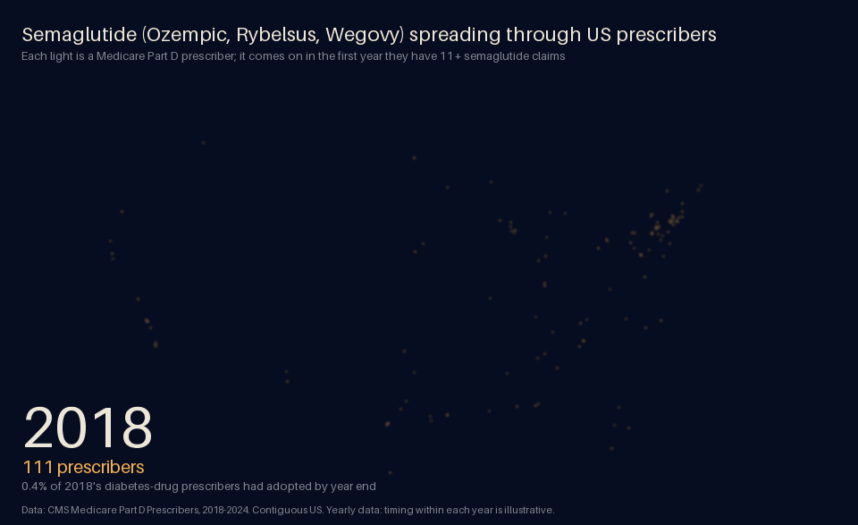
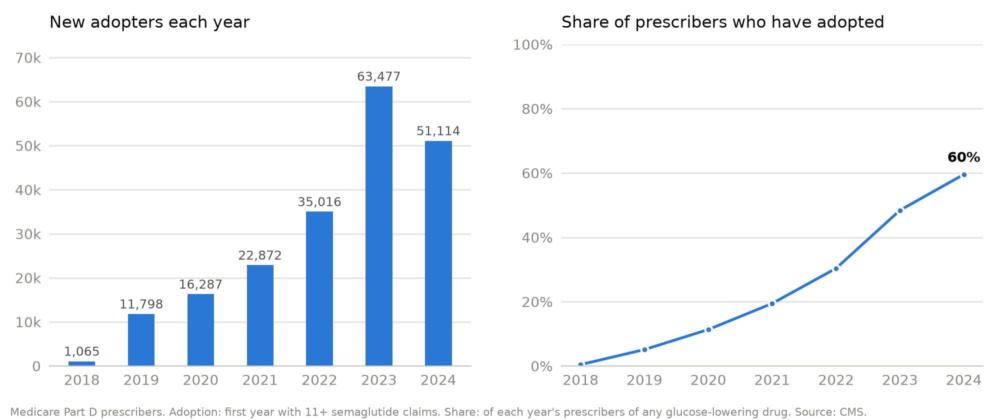
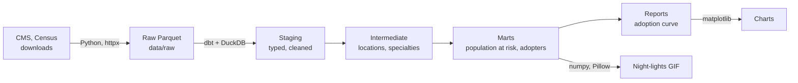

# semaglutide-spread

[](https://github.com/MyreLab/semaglutide-spread/actions/workflows/ci.yml)

How semaglutide (Ozempic, Rybelsus, Wegovy) spread through prescribers in the US and the UK, tracked like an epidemic.



*Each light is a Medicare Part D prescriber, switched on in the year they first prescribed semaglutide (11+ claims). Brighter areas have more adopters, partly because they have more prescribers. Timing within each year is illustrative: the data are yearly.*

> **Status:** Milestone 1 (US) is complete. The UK comparison is next; see the [roadmap](#roadmap).
> A personal project using public data. Not affiliated with, or endorsed by, any employer.

## The question

Epidemiologists track how a disease moves through a population: who catches it first, how fast it spreads, and where. This project asks the same questions about a new drug. Each prescriber (US) or GP practice (UK) "catches" semaglutide the first time they prescribe it in meaningful volume, and the project follows that spread over time and across the map.

## What the US data show (2018-2024)

<picture>
  <source media="(prefers-color-scheme: dark)" srcset="docs/images/us_adoption_curve_dark.png">
  
</picture>

- **201,629 Medicare prescribers adopted semaglutide in seven years.** By 2024, 60% of everyone prescribing a diabetes drug in Medicare Part D had prescribed it.
- **The spread accelerated, then may have started to slow.** Each year, a growing share of the prescribers who hadn't yet adopted did so: 5% in 2019, 15% in 2022 and 29% in 2023. In 2024 that share held at 28%, and the number of new adopters fell for the first time.
- **Specialists went first; primary care carried the spread.** Endocrinologists were 31% of the first 1,065 adopters in 2018, and by 2024, 86% of endocrinologists in Part D prescribed semaglutide. But in 2024, 58% of the prescribers using it were primary care physicians, and a quarter were nurse practitioners, up from 165 nurse practitioners in 2018 to 43,635.

## By the numbers

| | |
|---|---|
| Prescriber x drug x year rows processed | 181.8 million |
| Prescription claims they cover | 9.4 billion |
| Drug spending they cover | $1.2 trillion |
| Prescribers | 1.54 million |
| Prescriber-years placed on the map | 99.97% |
| Raw data | 33 GB of CSV, stored as 4.6 GB of Parquet |
| Automated checks on every build | 70 data tests, 61 code tests |

## Methods

### Data

| Country | Source | Unit | Time step |
|---|---|---|---|
| US | Medicare Part D Prescribers by Provider and Drug (CMS) | Individual prescriber | Year |
| England | English Prescribing Dataset (NHS Business Services Authority) | GP practice | Month |
| Scotland | Prescriptions in the Community (Public Health Scotland) | GP practice | Month |
| Northern Ireland | GP Prescribing Data (Business Services Organisation, via OpenDataNI) | GP practice | Month |
| Wales | GP practice prescribing (NHS Wales Shared Services Partnership) | GP practice | Month |

Milestone 1 uses the US data. Prescribers are placed on the map from their practice ZIP code, using Census ZIP Code Tabulation Areas and, where a ZIP code has none, the Census geocoder.

### Definitions

| Term | Definition |
|---|---|
| Population at risk | Prescribers with 11+ Part D claims for at least one glucose-lowering drug (WHO ATC class A10, semaglutide included) in that year |
| Adoption | A prescriber's first year with 11+ Part D claims for semaglutide, any brand (Ozempic, Rybelsus, Wegovy) |
| Susceptible | In the population at risk and not yet adopted |
| Incidence | New adopters / susceptible prescribers, each year |
| Prevalence | Prescribers who have ever adopted / that year's population at risk |

Specialty and location are taken from the year of adoption. 263 specialty labels are grouped into 13 groups.

### Limitations

- **Medicare only.** Part D covers people 65 and over and some younger people with disabilities. Most plans don't cover drugs for weight loss alone, so most weight-loss prescribing isn't in this data.
- **Yearly data.** Adoption is known to the year, not the month.
- **The 11-claim rule.** CMS hides any prescriber x drug x year with fewer than 11 claims. Adoption is therefore the first year a prescriber becomes *visible*, which can be later than their first prescription.
- **Claims, not patients.** A claim is one fill, refills included, so one patient on a monthly prescription is enough to reach 11 claims. Most adopters had fewer than 11 patients on semaglutide in their adoption year.
- **No diagnoses.** The data can't say why semaglutide was prescribed.

Every problem found in the source data, and how it was handled, is in [docs/data-notes.md](docs/data-notes.md).

## How it's built



- **Python 3.12** with [uv](https://docs.astral.sh/uv/) for downloads (resumable, retried, checked against expected columns and row counts) and charts.
- **dbt + DuckDB** for every transformation, as tested SQL models, from raw files to the analysis tables.
- **Quality checks:** data tests on the full data (uniqueness, completeness, value ranges, and that counts reconcile between layers), and an end-to-end test that builds the whole warehouse on a small made-up dataset with known answers.
- **GitHub Actions** runs formatting, lint and all tests on every pull request; `main` only changes through pull requests that pass.
- Built with Claude as a coding assistant. I set the questions and methods, made the analytical decisions, and reviewed and merged every pull request; tests and CI check every change.

## Run it yourself

Requires [uv](https://docs.astral.sh/uv/).

```bash
git clone https://github.com/MyreLab/semaglutide-spread.git
cd semaglutide-spread
uv sync                      # create the environment from uv.lock
uv run pre-commit install    # turn on the checks that run on every commit
uv run pytest                # run the tests, including a dbt build on made-up sample data
```

Download the data:

```bash
uv run partd-download        # Medicare Part D, 2018 to the latest year CMS has published
uv run census-download       # Census ZIP-area (ZCTA) reference files, ~2 MB
uv run geocode-addresses     # place prescribers whose ZIP code has no ZIP area (~4 minutes)
uv run epd-download          # England: diabetes drugs by GP practice and month (~1 hour)
```

The Part D download is about 33 GB of CSVs from data.cms.gov, one file at a time, stored as about 4.6 GB of Parquet in `data/raw/`. Allow about 10 GB of free disk space while it runs. Re-running only fetches years that are new or that CMS has re-published.

Build the warehouse and draw the figures:

```bash
uv run build-warehouse       # dbt build with all data tests: ~2 minutes, writes data/warehouse.duckdb
uv run night-lights          # docs/images/us_night_lights.gif and a still of the last year (~20 s)
uv run adoption-curve        # docs/images/us_adoption_curve_{light,dark}.png
```

## Project layout

```
src/semaglutide_spread/   Python code: downloads, geocoding, maps and charts
dbt/                      SQL models that clean and combine the data, with data tests
tests/                    automated tests, including the made-up sample data
docs/                     notes on the data, and the images shown in this README
data/                     downloaded and built data (not committed; see data/README.md)
```

## Roadmap

- [x] **M1: US adoption.** Part D 2018-2024, population at risk, first adoption, US night-lights GIF
- [ ] **M2: UK.** Monthly GP practice data for England, Scotland, Northern Ireland and Wales, same measures, UK night-lights GIF
- [ ] **M3: Compare.** Epidemic curves, specialty breakdown, US vs UK, adoption rates by county
- [ ] **M4: Agents.** Claude-powered helpers for drug-name matching, data quality triage and questions

## Author

Myrela Bauman: epidemiologist, data engineer. [GitHub](https://github.com/MyreLab)

## License

MIT
