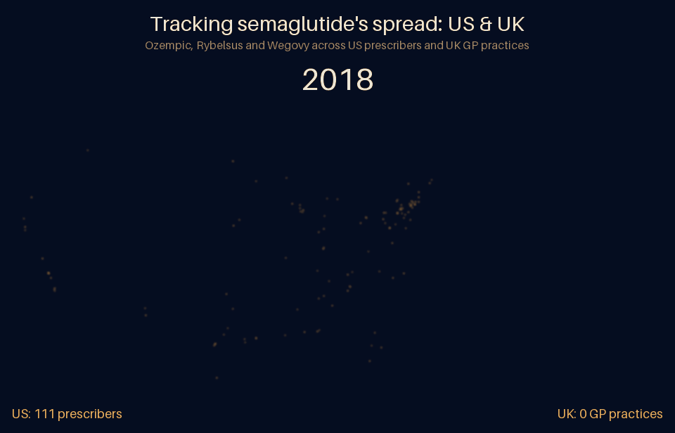
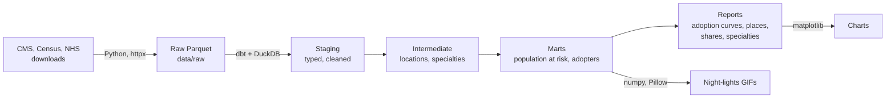
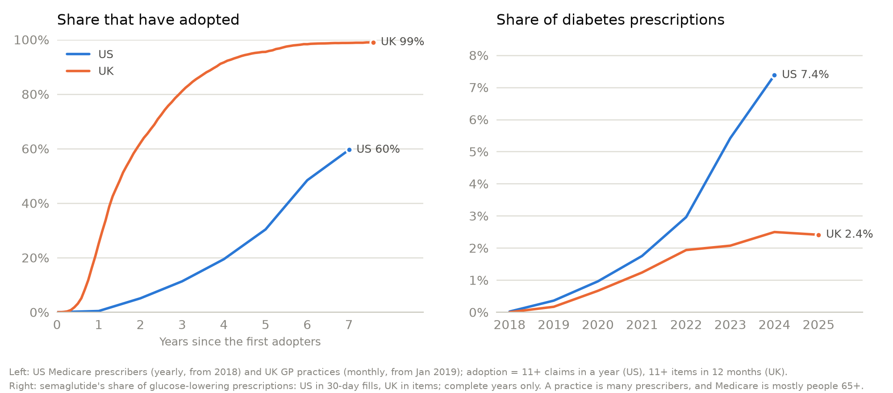
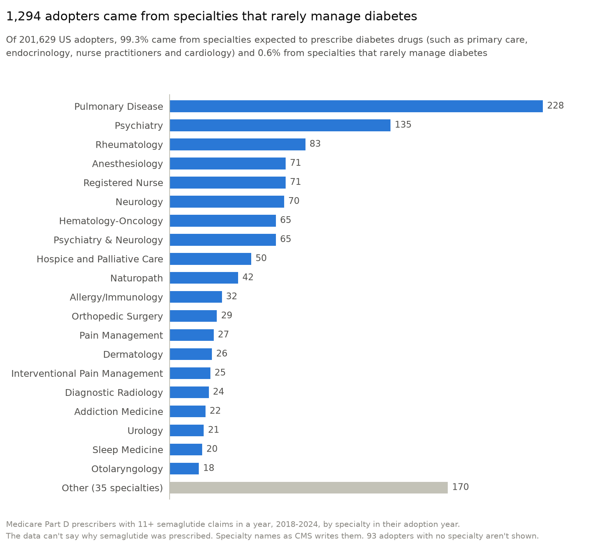

# semaglutide-spread

[](https://github.com/MyreLab/semaglutide-spread/actions/workflows/ci.yml)

A data pipeline that tracks how semaglutide (Ozempic, Rybelsus, Wegovy) spread through prescribers in the US and the UK, built on public prescribing data with Python, dbt and DuckDB.



*Each light is a US Medicare Part D prescriber (left) or a UK GP practice (right), switched on when it first reaches 11+ semaglutide prescriptions in a year.*

## The question

Epidemiologists track how a disease moves through a population: who catches it first, how fast it spreads, and where. This project asks the same questions about semaglutide, as Coleman, Katz and Menzel did for a new antibiotic in 1950s Illinois (*Medical Innovation: A Diffusion Study*, 1966). Each prescriber (US) or GP practice (UK) "catches" semaglutide the first time they prescribe it in meaningful volume: 11+ prescriptions in a year.

## How it's built



- **Ingestion (Python).** One downloader per source. Downloads are resumable and retried, columns are checked against what the publisher documents, and row counts or totals are checked before anything is saved. Everything lands as text-only Parquet, partitioned by year or month, so column types are decided in one place (dbt) instead of guessed on load.
- **Transformation (dbt on DuckDB).** Staging models type and clean each source, intermediate models handle locations and specialties, and marts hold the population at risk and the adopters. Hand-maintained lookups, like the list of diabetes drugs and the specialty groups, are dbt seeds with a reason on each row.
- **Testing.** dbt tests run on the full data at every build, including checks that counts reconcile between layers. A pytest suite also builds the whole warehouse on a small made-up dataset with answers worked out in advance.
- **CI.** GitHub Actions runs formatting, lint and all tests on every pull request; `main` only changes through pull requests that pass.
- **Outputs.** Charts in matplotlib; the maps are drawn with numpy and Pillow.

| | US | UK |
|---|---|---|
| Rows ingested | 182M (prescriber x drug x year) | 21.6M (practice x drug x month) |
| Prescriptions those rows summarise | 9.4B claims | 12.2B items |
| Prescribers | 1.54M individual prescribers | 9,134 GP practices |
| Placed on the map | 99.97% | 99.6% |
| Storage | 33 GB of CSV, 4.6 GB as Parquet | 0.3 GB of Parquet (filtered on download) |

## What I found

<picture>
  <source media="(prefers-color-scheme: dark)" srcset="docs/images/us_uk_comparison_dark.png">
  
</picture>

- **The UK took it up faster.** Half of UK GP practices had adopted semaglutide 18 months after the first ones did. US prescribers took six years to get close (48%). Some of that gap is the unit: a UK practice counts as adopting as soon as any one of its GPs does.
- **But the US uses more of it.** In 2024, semaglutide was 7.4% of Medicare's diabetes prescriptions and 2.5% of the UK's.
- **Specialists first, then primary care.** Endocrinologists were 2% of US diabetes prescribers in 2018 but 31% of that year's adopters. Primary care doctors and nurse practitioners carried it from there.
- **Rural US went further; London came last.** By 2024, 75% of US prescribers in small towns and rural areas had adopted, against 57% in metropolitan areas. In the UK, Wales led and London trailed throughout.
- **And some unexpected prescribers.** 1,294 US adopters (0.6%) came from specialties that rarely manage diabetes, mostly pulmonology, psychiatry and rheumatology, plus 42 naturopaths and 7 dentists.

<picture>
  <source media="(prefers-color-scheme: dark)" srcset="docs/images/us_unexpected_specialties_dark.png">
  
</picture>

## Problems I ran into

Most of the work was in the data, not the code. A few problems that changed the design:

- **ZIP codes that aren't places.** About 2% of Medicare's ZIP codes have no Census ZIP area to map to; they mostly belong to large medical centres with their own ZIP code. I geocoded those 12,391 addresses and filled the failures from nearby matches, which puts 99.97% of prescriber-years on the map. The build fails if any year drops below 99%.
- **A column that changed meaning.** In March 2025, England's prescribing data started putting drug names in the column that used to hold drug codes. Read the old way, it returns zero diabetes prescriptions and no error. The downloader now checks each month's columns against the layouts it knows and stops on anything new.
- **A Census file from the wrong decade.** The file labelled "2020 Gazetteer" lists the 2010 ZIP areas. A dbt test comparing it with another Census file caught the mismatch (851 ZIP areas in one but not the other), and the downloader now checks the row count the Census Bureau publishes.
- **Searching for diabetes drugs finds the wrong things.** A text search of Medicare's drug names also returns insulin syringes and metolazone, a diuretic. The drug list is now a dbt seed based on the WHO's diabetes drug group, and a test fails if Medicare publishes a new name nobody has classified.
- **Paging an API without losing rows.** England's and Scotland's portals return 32,000 rows per request, and without a fixed sort order pages can overlap or skip rows. Every download uses a fixed order and is checked against a separate total before it's saved.

## Data

| Country | Source | Unit | Time step |
|---|---|---|---|
| US | [Medicare Part D Prescribers by Provider and Drug](https://data.cms.gov/provider-summary-by-type-of-service/medicare-part-d-prescribers/medicare-part-d-prescribers-by-provider-and-drug) (CMS) | Individual prescriber | Year |
| England | [English Prescribing Dataset](https://opendata.nhsbsa.net/dataset/english-prescribing-dataset-epd-with-snomed-code) (NHS Business Services Authority) | GP practice | Month |
| Scotland | [Prescriptions in the Community](https://www.opendata.nhs.scot/dataset/prescriptions-in-the-community) (Public Health Scotland) | GP practice | Month |
| Northern Ireland | [GP Prescribing Data](https://www.opendatani.gov.uk/dataset/gp-prescribing-data) (Business Services Organisation, via OpenDataNI) | GP practice | Month |
| Wales | [GP practice prescribing](https://nwssp.nhs.wales/ourservices/primary-care-services/general-information/data-and-publications/prescribing-data-extracts/general-practice-prescribing-data-extract/) (NHS Wales Shared Services Partnership) | GP practice | Month |

The limitations that matter most:

- The US data are Medicare Part D only: mostly people 65 and over, with no private insurance and no Medicaid (Medicaid doesn't publish prescribing by prescriber).
- CMS hides any prescriber-drug row with fewer than 11 claims, so US adoption is the first year a prescriber becomes visible, not necessarily their first prescription.
- The UK data count GP practices, not individual prescribers, and leave out private prescriptions, including online weight-loss services.
- Neither country's data says why semaglutide was prescribed.

The full list, with definitions, is in [docs/methods.md](docs/methods.md), and year-by-year results for each country are in [docs/results.md](docs/results.md).

## Working with Claude Code

I built this with Claude Code as a pair programmer. I chose the questions and the data sources, laid out the architecture I wanted, and made the analytical decisions. I reviewed every pull request before merging. Claude was confidently wrong more than once: it told me the Welsh data only went back to 2024 when the archive went back to 2018, and its first grouping of medical specialties didn't match who actually manages diabetes, so I reclassified them. The tests were my other safeguard: if a change makes the pipeline give the wrong answers on the test dataset, CI fails and it can't be merged.

## If this were production

- Run dbt on Snowflake instead of DuckDB, with raw files in S3. Most models would carry over as they are; a few DuckDB-specific pieces, like the as-of joins and reading Parquet straight from disk, would need rewriting.
- Schedule the downloaders and the dbt build with Dagster or Airflow, monthly, as the sources publish.
- Make the largest models incremental instead of rebuilding everything each time.
- Publish the dbt docs and lineage graph.

## Run it yourself

Requires [uv](https://docs.astral.sh/uv/).

```bash
git clone https://github.com/MyreLab/semaglutide-spread.git
cd semaglutide-spread
uv sync                      # create the environment from uv.lock
uv run pre-commit install    # turn on the checks that run on every commit
uv run pytest                # run the tests, including a dbt build on made-up sample data
```

To run the full pipeline, download the data:

```bash
uv run partd-download        # Medicare Part D, 2018 to the latest year CMS has published
uv run census-download       # Census ZIP-area (ZCTA) reference files, ~2 MB
uv run geocode-addresses     # place prescribers whose ZIP code has no ZIP area (~4 minutes)
uv run epd-download          # England: diabetes drugs by GP practice and month (~1 hour)
uv run ods-download          # England: which prescribing codes are GP practices (seconds)
uv run phs-download          # Scotland: prescribing by GP practice, and the practice register (~15 minutes)
uv run ni-download           # Northern Ireland: prescribing by GP practice, and practice lists (~30 minutes)
uv run wales-download        # Wales: prescribing by GP practice, and practice addresses (~10 minutes)
uv run postcode-lookup       # UK practice postcodes to locations and NHS areas (~1 minute)
```

The Part D download is about 33 GB of CSVs from data.cms.gov, one file at a time, stored as about 4.6 GB of Parquet in `data/raw/`. Allow about 10 GB of free disk space while it runs. Re-running only fetches years that are new or that CMS has re-published.

Build the warehouse and draw the figures:

```bash
uv run build-warehouse       # dbt build with all data tests: ~3 minutes, writes data/warehouse.duckdb
uv run night-lights          # docs/images/{us,uk}_night_lights.gif and a still of each last frame (~45 s);
                             # --detailed adds the small print, for sharing a map on its own
uv run night-lights-combined # docs/images/us_uk_night_lights.gif: both countries on one clock (~30 s)
uv run adoption-curve        # docs/images/{us,uk}_adoption_curve_*.png and uk_nations_adoption_*.png
uv run comparison-chart      # docs/images/us_uk_comparison_*.png
uv run specialty-chart       # docs/images/us_unexpected_specialties_*.png
uv run social-preview        # docs/images/social_preview.png, the image shown when the repo is shared
```


## Roadmap

- [x] **M1: US adoption.** Part D 2018-2024, population at risk, first adoption, US night-lights GIF
- [x] **M2: UK.** Monthly GP practice data for England, Scotland, Northern Ireland and Wales, same measures, UK night-lights GIF
- [x] **M3: Compare.** Who prescribed it first, how fast it spread and where, US vs UK
- [ ] **M4: Agents.** Claude-powered helpers for drug-name matching, data quality triage and questions

## Author

Myrela Bauman: epidemiologist, data engineer. [GitHub](https://github.com/MyreLab)

## License

MIT
