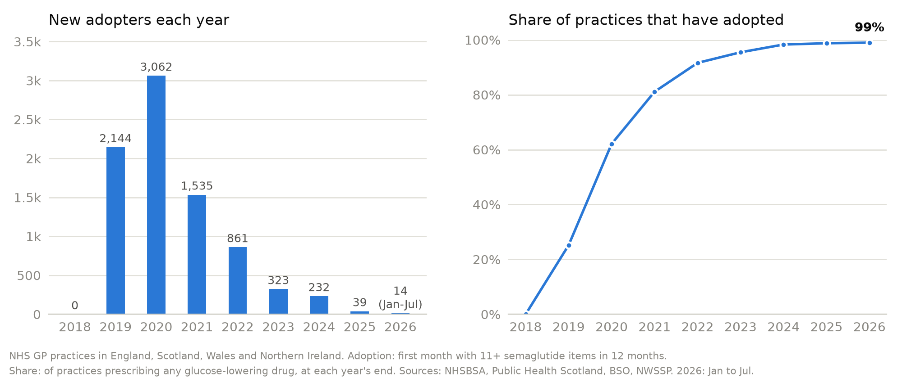
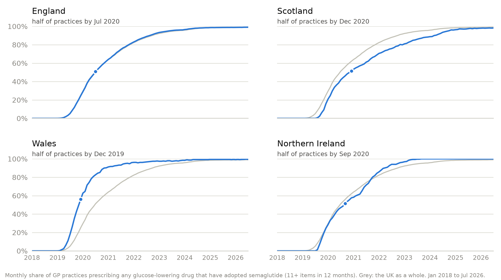
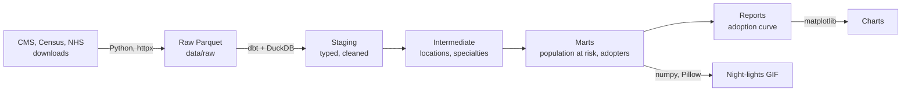

# semaglutide-spread

[](https://github.com/MyreLab/semaglutide-spread/actions/workflows/ci.yml)

How semaglutide (Ozempic, Rybelsus, Wegovy) spread through prescribers in the US and the UK, tracked like an epidemic.


*Each light is a Medicare Part D prescriber, switched on in the year they first prescribed semaglutide (11+ claims). Brighter areas have more adopters, partly because they have more prescribers. Timing within each year is illustrative: the data are yearly. Data: CMS Medicare Part D Prescribers, 2018-2024, contiguous US.*

> **Status:** Milestones 1 (US) and 2 (UK) are complete. Comparing the two is next; see the [roadmap](#roadmap).

## The question

Epidemiologists track how a disease moves through a population: who catches it first, how fast it spreads, and where. This project asks the same questions about a new drug, as Coleman, Katz and Menzel did for a new antibiotic among doctors in 1950s Illinois (*Medical Innovation: A Diffusion Study*, 1966). Each prescriber (US) or GP practice (UK) "catches" semaglutide the first time they prescribe it in meaningful volume, and the project follows that spread over time and across the map.

## What the US data show (2018-2024)

<picture>
  <source media="(prefers-color-scheme: dark)" srcset="docs/images/us_adoption_curve_dark.png">
  
</picture>

- **201,629 Medicare prescribers adopted semaglutide in seven years.** By 2024, 60% of everyone prescribing a diabetes drug in Medicare Part D had prescribed it.
- **The spread accelerated, then may have started to slow.** Each year, a growing share of the prescribers who hadn't yet adopted did so: 5% in 2019, 15% in 2022 and 29% in 2023. In 2024 that share held at 28%, and the number of new adopters fell for the first time.
- **Specialists went first; primary care carried the spread.** Endocrinologists were 31% of the first 1,065 adopters in 2018, and by 2024, 86% of endocrinologists in Part D prescribed semaglutide. But in 2024, 58% of the prescribers using it were primary care physicians, and a quarter were nurse practitioners, up from 165 nurse practitioners in 2018 to 43,635.

## What the UK data show (2018-2026)


*Each light is an NHS GP practice in England, Scotland, Wales or Northern Ireland, switched on in the first month its past 12 months add up to 11+ semaglutide items, the closest match to the US rule (11+ claims in a year). Both maps run at the same pace, 1.2 seconds a year; the UK's runs longer because its data go to July 2026. The UK data are monthly, so the timing is real to the month. Brighter areas have more adopting practices, partly because they have more practices. Data: NHSBSA (England), Public Health Scotland, BSO (Northern Ireland) and NWSSP (Wales).*

<picture>
  <source media="(prefers-color-scheme: dark)" srcset="docs/images/uk_adoption_curve_dark.png">
  
</picture>

- **8,210 GP practices adopted semaglutide.** By July 2026, 99% of UK practices prescribing a diabetes drug had reached 11+ semaglutide items in 12 months.
- **Fast once it started.** The first practices reached the threshold in January 2019. A tenth of practices had adopted by September 2019, half by July 2020 and 90% by October 2022. New adopters peaked at 3,062 in 2020, fell to a few hundred a year in 2023 and 2024, and to dozens since, because almost no practice is left to adopt.
- **Each nation took its own path.** Wales reached half of its practices first (December 2019), then England (July 2020), Northern Ireland (September 2020) and Scotland (December 2020). Scotland and Northern Ireland started later (August 2019) than England (January 2019) and Wales (February 2019), and Scotland was the last to reach 90% (April 2024).
- **Nearly every practice, but a small share of prescriptions.** In 2025, semaglutide was 2.4% of the UK's glucose-lowering prescription items: 2.2% in England, 2.8% in Wales, 4.8% in Northern Ireland and 5.0% in Scotland.

<picture>
  <source media="(prefers-color-scheme: dark)" srcset="docs/images/uk_nations_adoption_dark.png">
  
</picture>

## US and UK: what's being compared

The two countries' data differ in what they count, so the comparison is about the shape and timing of the spread, not its level.

| | US | UK |
|---|---|---|
| Who adopts | An individual prescriber | A GP practice (all of its prescribers) |
| Patients covered | Medicare Part D: mostly people 65 and over | NHS GP patients of all ages |
| Prescriptions | Filled at pharmacies | Dispensed in the community (pharmacies, dispensing practices) |
| Adoption | First year with 11+ claims | First month with 11+ items in the past 12 months |
| Population at risk | 11+ claims for a glucose-lowering drug that year | 1+ glucose-lowering item that month |
| Not in the data | Private insurance, Medicaid, hospitals | Private prescriptions, hospitals, specialist weight-management services |

A first look, ahead of Milestone 3:

- **UK practices adopted faster than US prescribers.** Half of UK practices adopted within 18 months of the first, while US prescribers reached 48% after six years. Much of that gap is built in: a practice adopts when any one of its GPs does, and the US data can miss prescribers who use semaglutide mainly for patients under 65.
- **US use is heavier.** In 2024, semaglutide was 7.4% of Medicare's glucose-lowering prescriptions (counted in 30-day fills) and 2.5% of the UK's items. Both are shares of diabetes prescriptions, but Medicare's patients are older and the two countries count prescriptions differently, so this is a first look, not a verdict.

## By the numbers

| | US | UK |
|---|---|---|
| Rows processed | 181.8 million (prescriber x drug x year) | 21.6 million (practice x drug x month) |
| Prescriptions they cover | 9.4 billion claims | 12.2 billion items |
| Drug spending they cover | $1.2 trillion | |
| Prescribers | 1.54 million prescribers | 9,134 GP practices |
| Placed on the map | 99.97% of prescriber-years | 99.6% of practice-months |
| Raw data | 33 GB of CSV, stored as 4.6 GB of Parquet | 0.3 GB of Parquet, filtered to diabetes drugs on download |

21.6 billion prescriptions in all. Every build runs 120 data tests and 103 code tests.

## Methods

### Data

| Country | Source | Unit | Time step |
|---|---|---|---|
| US | Medicare Part D Prescribers by Provider and Drug (CMS) | Individual prescriber | Year |
| England | English Prescribing Dataset (NHS Business Services Authority) | GP practice | Month |
| Scotland | Prescriptions in the Community (Public Health Scotland) | GP practice | Month |
| Northern Ireland | GP Prescribing Data (Business Services Organisation, via OpenDataNI) | GP practice | Month |
| Wales | GP practice prescribing (NHS Wales Shared Services Partnership) | GP practice | Month |

US prescribers are placed on the map from their practice ZIP code, using Census ZIP Code Tabulation Areas and, where a ZIP code has none, the Census geocoder. UK practices are placed from their postcode, using [postcodes.io](https://postcodes.io) (built on the ONS Postcode Directory). Only GP practices are kept: in England and Wales, codes the NHS Organisation Data Service lists as GP practices; in Scotland and Northern Ireland, practices in each nation's practice register.

### Definitions

| Term | US | UK |
|---|---|---|
| Glucose-lowering drugs | WHO ATC class A10 | BNF 6.1.1 and 6.1.2 (insulins and antidiabetic drugs) |
| Population at risk | Prescribers with 11+ Part D claims for at least one glucose-lowering drug (semaglutide included) in that year | GP practices with 1+ glucose-lowering item in that month |
| Adoption | First year with 11+ claims for semaglutide, any brand (Ozempic, Rybelsus, Wegovy) | First month whose past 12 months add up to 11+ semaglutide items, any brand (the first month with 1+ item is also kept) |
| Susceptible | In the population at risk and not yet adopted | Same |
| Incidence | New adopters / susceptible, each year | Same, each month |
| Prevalence | Ever adopted / that year's population at risk | Same, each month |

Specialty and location are taken from the year (US) or month (UK) of adoption. In the US, 263 specialty labels are grouped into 13 groups.

### Limitations

US:

- **Medicare only.** Part D covers people 65 and over and some younger people with disabilities. Most plans don't cover drugs for weight loss alone, so most weight-loss prescribing isn't in this data.
- **Yearly data.** Adoption is known to the year, not the month.
- **The 11-claim rule.** CMS hides any prescriber x drug x year with fewer than 11 claims. Adoption is therefore the first year a prescriber becomes *visible*, which can be later than their first prescription.
- **Claims, not patients.** A claim is one fill, refills included, so one patient on a monthly prescription is enough to reach 11 claims. Most adopters had fewer than 11 patients on semaglutide in their adoption year.
- **No Medicaid.** Medicaid publishes prescriptions by state and drug, but not by prescriber, so it can't be added.
- **No diagnoses.** The data can't say why semaglutide was prescribed.

UK:

- **Practices, not prescribers.** One adopting GP turns on the whole practice.
- **NHS GP prescribing only.** Private prescriptions, including online weight-loss services, and specialist NHS weight-management services aren't in the data.
- **No patient ages or diagnoses.** The data can't be limited to older patients, or say why semaglutide was prescribed.
- **Scotland's months are when the pharmacy was paid,** usually a month after dispensing; the other nations' are when it was dispensed.

Every problem found in the source data, and how it was handled, is in [docs/data-notes.md](docs/data-notes.md).

## How it's built



- **Python 3.12** with [uv](https://docs.astral.sh/uv/) for downloads (resumable, retried, checked against expected columns and row counts) and charts.
- **dbt + DuckDB** for every transformation, as tested SQL models, from raw files to the analysis tables.
- **Quality checks:** data tests on the full data (uniqueness, completeness, value ranges, and that counts reconcile between layers), and an end-to-end test that builds the whole warehouse on a small made-up dataset with known answers.
- **GitHub Actions** runs formatting, lint and all tests on every pull request; `main` only changes through pull requests that pass.
- Built with Claude as a coding assistant. I set the questions and methods, made the analytical decisions, and reviewed and merged every pull request; tests and CI check every change.

## Run it yourself

Requires [uv](https://docs.astral.sh/uv/).

```bash
git clone https://github.com/MyreLab/semaglutide-spread.git
cd semaglutide-spread
uv sync                      # create the environment from uv.lock
uv run pre-commit install    # turn on the checks that run on every commit
uv run pytest                # run the tests, including a dbt build on made-up sample data
```

Download the data:

```bash
uv run partd-download        # Medicare Part D, 2018 to the latest year CMS has published
uv run census-download       # Census ZIP-area (ZCTA) reference files, ~2 MB
uv run geocode-addresses     # place prescribers whose ZIP code has no ZIP area (~4 minutes)
uv run epd-download          # England: diabetes drugs by GP practice and month (~1 hour)
uv run ods-download          # England: which prescribing codes are GP practices (seconds)
uv run phs-download          # Scotland: prescribing by GP practice, and the practice register (~15 minutes)
uv run ni-download           # Northern Ireland: prescribing by GP practice, and practice lists (~30 minutes)
uv run wales-download        # Wales: prescribing by GP practice, and practice addresses (~10 minutes)
uv run postcode-lookup       # UK practice postcodes to locations and NHS areas (~1 minute)
```

The Part D download is about 33 GB of CSVs from data.cms.gov, one file at a time, stored as about 4.6 GB of Parquet in `data/raw/`. Allow about 10 GB of free disk space while it runs. Re-running only fetches years that are new or that CMS has re-published.

Build the warehouse and draw the figures:

```bash
uv run build-warehouse       # dbt build with all data tests: ~2 minutes, writes data/warehouse.duckdb
uv run night-lights          # docs/images/{us,uk}_night_lights.gif and a still of each last frame (~45 s);
                             # --detailed adds the small print, for sharing a map on its own
uv run adoption-curve        # docs/images/{us,uk}_adoption_curve_*.png and uk_nations_adoption_*.png
```

## Project layout

```
src/semaglutide_spread/   Python code: downloads, geocoding, maps and charts
dbt/                      SQL models that clean and combine the data, with data tests
tests/                    automated tests, including the made-up sample data
docs/                     notes on the data, and the images shown in this README
data/                     downloaded and built data (not committed; see data/README.md)
```

## Roadmap

- [x] **M1: US adoption.** Part D 2018-2024, population at risk, first adoption, US night-lights GIF
- [x] **M2: UK.** Monthly GP practice data for England, Scotland, Northern Ireland and Wales, same measures, UK night-lights GIF
- [ ] **M3: Compare.** Epidemic curves, specialty breakdown, US vs UK, adoption rates by county
- [ ] **M4: Agents.** Claude-powered helpers for drug-name matching, data quality triage and questions

## Author

Myrela Bauman: epidemiologist, data engineer. [GitHub](https://github.com/MyreLab)

## License

MIT
