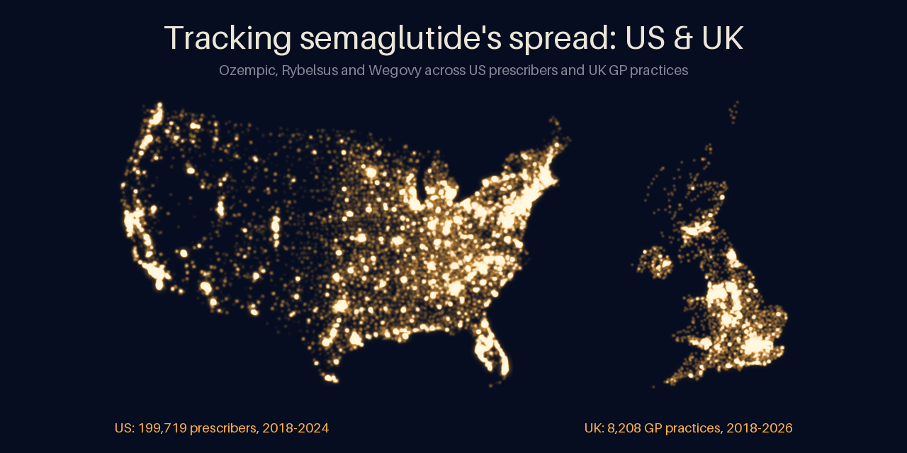
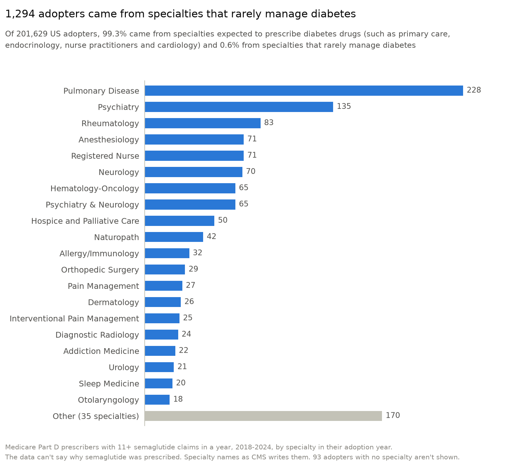
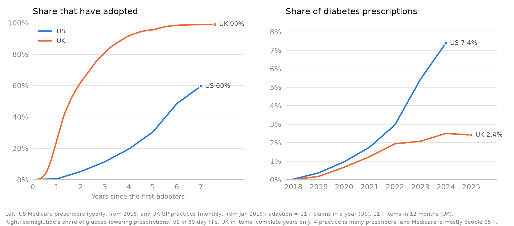
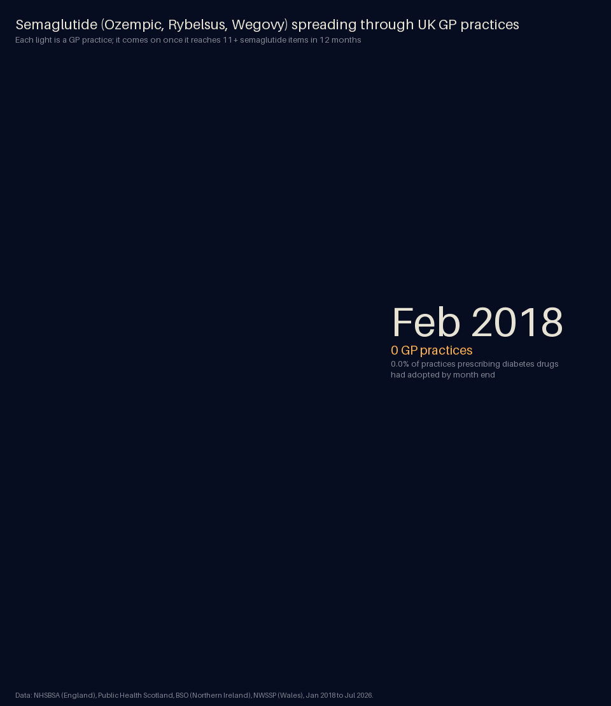
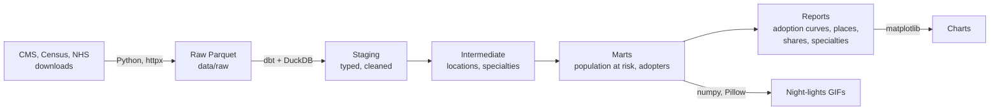

# semaglutide-spread

[](https://github.com/MyreLab/semaglutide-spread/actions/workflows/ci.yml)

This data engineering project tracks semaglutide (Ozempic, Rybelsus, Wegovy) like an epidemic: who prescribed it first, how fast it spread, and where, in the US and the UK. Python pipelines download and validate data covering 9.4 billion Medicare claims and 12.2 billion UK prescriptions into Parquet, and dbt models in DuckDB turn it into adoption curves and maps. Each build runs 152 data tests and 110 code tests, and GitHub Actions checks every pull request.



## The question

Epidemiologists track how a disease moves through a population: who catches it first, how fast it spreads, and where. This project asks the same questions about a new drug, as Coleman, Katz and Menzel did for a new antibiotic among doctors in 1950s Illinois (*Medical Innovation: A Diffusion Study*, 1966). Each prescriber (US) or GP practice (UK) "catches" semaglutide the first time they prescribe it in meaningful volume: 11+ prescriptions in a year.

## Who prescribed it first

- **US: endocrinologists.** They were 2% of US diabetes-drug prescribers in 2018 but 31% of that year's 1,065 adopters, and 43% of them had adopted by the end of 2019, when 5% of all prescribers had. Primary care then carried the spread: in 2024, 58% of the prescribers using semaglutide were primary care physicians and a quarter were nurse practitioners.
- **UK: the practices that prescribe most for diabetes.** The UK data are by GP practice, not prescriber, so they have no specialty. At the end of 2019, practices that had adopted wrote a median of 651 diabetes prescriptions a month, against 450 for those that hadn't. Part of that is built in: a practice with more diabetes patients reaches 11 prescriptions sooner. England's practices were first (January 2019), then Wales (February), Scotland and Northern Ireland (August).

<picture>
  <source media="(prefers-color-scheme: dark)" srcset="docs/images/us_unexpected_specialties_dark.png">
  
</picture>

- **Who else: 0.6% of US adopters (1,294 prescribers) came from specialties that rarely manage diabetes,** led by pulmonology (228), psychiatry (135) and rheumatology (83), and including 42 naturopaths, 26 dermatologists and 7 dentists. The other 99.3% came from specialties expected to prescribe diabetes drugs. Each specialty's classification, and the reason for it, is in [dbt/seeds/specialty_expectations.csv](dbt/seeds/specialty_expectations.csv).

## How fast it spread

<picture>
  <source media="(prefers-color-scheme: dark)" srcset="docs/images/us_uk_comparison_dark.png">
  
</picture>

- **US: slowly, then faster.** 5% of diabetes-drug prescribers had adopted by the end of 2019, 19% by 2021, 48% by 2023 and 60% by 2024. Each year a larger share of those who hadn't adopted did so, from 5% in 2019 to 29% in 2023. In 2024 that share held at 28%, and new adopters fell for the first time (63,477 to 51,114).
- **UK: fast and almost complete.** Half of GP practices adopted within 18 months of the first (by July 2020), 90% by October 2022 and 99% by July 2026. Part of the gap with the US is built in: a practice adopts when any one of its GPs does.
- **But it runs deeper in the US.** Semaglutide's share of diabetes prescriptions was similar in the two countries until 2021. By 2024 it was 7.4% in the US and 2.5% in the UK, where it has stayed since: nearly every UK practice prescribes it, but in small amounts.

Year-by-year charts for each country, and for each UK nation, are in [docs/results.md](docs/results.md).

## Where it spread


*Each light is a Medicare Part D prescriber, switched on in the first year they have 11+ semaglutide claims. Brighter areas have more adopters, partly because they have more prescribers. Timing within each year is illustrative: the data are yearly. Contiguous US.*

- **US: the South-east first, and rural areas furthest.** At the end of 2019, 12% of Alabama's diabetes-drug prescribers had adopted, followed by Mississippi, North Carolina, West Virginia and South Carolina, against under 2% in Colorado, Maine and Utah. By 2024, 75% of prescribers in small towns and rural areas had adopted, against 57% in metropolitan areas.



*Each light is an NHS GP practice in England, Scotland, Wales or Northern Ireland, switched on in the first month its past 12 months add up to 11+ semaglutide prescriptions. Both maps run at the same pace, 1.2 seconds a year; the UK's runs longer because its data go to July 2026.*

- **UK: Wales first, London last.** At the end of 2019, 56% of Welsh practices had adopted, against 7% in London. Two years later London was still the slowest (66%, against 96% in Wales). Unlike the US, rural and urban practices in England and Wales adopted at the same pace.

**Comparing the two countries:** US data cover Medicare Part D, mostly people 65 and over, and count individual prescribers; UK data cover all NHS GP patients and count practices. So the comparison is about the shape and timing of the spread, not its level. Sources, definitions and limitations are in [docs/methods.md](docs/methods.md).

## How it's built



- **Python 3.12** with [uv](https://docs.astral.sh/uv/) for downloads from eight public sources (resumable, retried, checked against expected columns and row counts) and for the maps and charts.
- **dbt + DuckDB** for every transformation, as tested SQL models, from raw files to the analysis tables.
- **Quality checks:** data tests on the full data (uniqueness, completeness, value ranges, and that counts reconcile between layers), and an end-to-end test that builds the whole warehouse on a small made-up dataset with known answers.
- **GitHub Actions** runs formatting, lint and all tests on every pull request; `main` only changes through pull requests that pass.
- Built with Claude as a coding assistant. I set the questions and methods, made the analytical decisions, and reviewed and merged every pull request; tests and CI check every change.

| | US | UK |
|---|---|---|
| Rows processed | 181.8 million (prescriber x drug x year) | 21.6 million (practice x drug x month) |
| Prescriptions they cover | 9.4 billion claims | 12.2 billion items |
| Prescribers | 1.54 million prescribers | 9,134 GP practices |
| Placed on the map | 99.97% of prescriber-years | 99.6% of practice-months |
| Raw data | 33 GB of CSV, stored as 4.6 GB of Parquet | 0.3 GB of Parquet, filtered to diabetes drugs on download |

Every problem found in the source data, and how it was handled, is in [docs/data-notes.md](docs/data-notes.md).

## Run it yourself

Requires [uv](https://docs.astral.sh/uv/).

```bash
git clone https://github.com/MyreLab/semaglutide-spread.git
cd semaglutide-spread
uv sync                      # create the environment from uv.lock
uv run pre-commit install    # turn on the checks that run on every commit
uv run pytest                # run the tests, including a dbt build on made-up sample data
```

<details>
<summary><b>Full pipeline:</b> download the data, build the warehouse and draw the figures</summary>

Download the data:

```bash
uv run partd-download        # Medicare Part D, 2018 to the latest year CMS has published
uv run census-download       # Census ZIP-area (ZCTA) reference files, ~2 MB
uv run geocode-addresses     # place prescribers whose ZIP code has no ZIP area (~4 minutes)
uv run epd-download          # England: diabetes drugs by GP practice and month (~1 hour)
uv run ods-download          # England: which prescribing codes are GP practices (seconds)
uv run phs-download          # Scotland: prescribing by GP practice, and the practice register (~15 minutes)
uv run ni-download           # Northern Ireland: prescribing by GP practice, and practice lists (~30 minutes)
uv run wales-download        # Wales: prescribing by GP practice, and practice addresses (~10 minutes)
uv run postcode-lookup       # UK practice postcodes to locations and NHS areas (~1 minute)
```

The Part D download is about 33 GB of CSVs from data.cms.gov, one file at a time, stored as about 4.6 GB of Parquet in `data/raw/`. Allow about 10 GB of free disk space while it runs. Re-running only fetches years that are new or that CMS has re-published.

Build the warehouse and draw the figures:

```bash
uv run build-warehouse       # dbt build with all data tests: ~3 minutes, writes data/warehouse.duckdb
uv run night-lights          # docs/images/{us,uk}_night_lights.gif and a still of each last frame (~45 s);
                             # --detailed adds the small print, for sharing a map on its own
uv run adoption-curve        # docs/images/{us,uk}_adoption_curve_*.png and uk_nations_adoption_*.png
uv run comparison-chart      # docs/images/us_uk_comparison_*.png
uv run specialty-chart       # docs/images/us_unexpected_specialties_*.png
uv run social-preview        # docs/images/social_preview.png, the image shown when the repo is shared
```

</details>

## Roadmap

- [x] **M1: US adoption.** Part D 2018-2024, population at risk, first adoption, US night-lights GIF
- [x] **M2: UK.** Monthly GP practice data for England, Scotland, Northern Ireland and Wales, same measures, UK night-lights GIF
- [x] **M3: Compare.** Who prescribed it first, how fast it spread and where, US vs UK
- [ ] **M4: Agents.** Claude-powered helpers for drug-name matching, data quality triage and questions

## Author

Myrela Bauman: epidemiologist, data engineer. [GitHub](https://github.com/MyreLab)

## License

MIT
