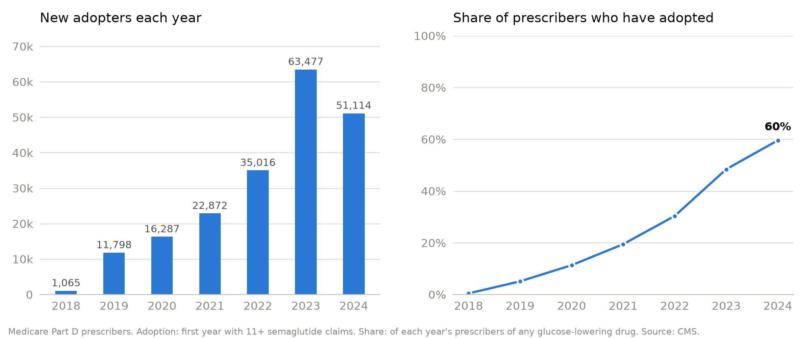
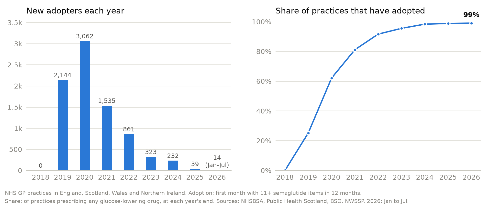
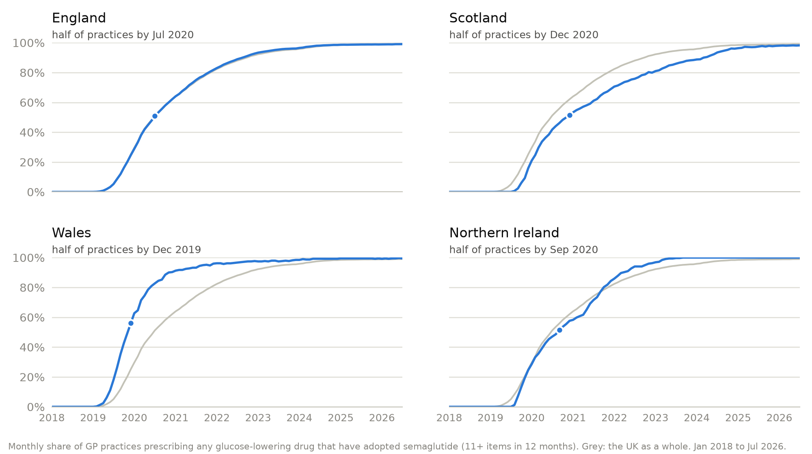

# Results in detail

The [README](../README.md) answers the three questions: who prescribed semaglutide first, how fast it spread, and where. This page has the year-by-year detail for each country. Definitions are in [methods.md](methods.md).

## US (2018-2024)

<picture>
  <source media="(prefers-color-scheme: dark)" srcset="images/us_adoption_curve_dark.png">
  
</picture>

- **201,629 Medicare prescribers adopted semaglutide in seven years.** By 2024, 60% of everyone prescribing a diabetes drug in Medicare Part D had prescribed it.
- **The spread accelerated, then may have started to slow.** Each year, a growing share of the prescribers who hadn't yet adopted did so: 5% in 2019, 15% in 2022 and 29% in 2023. In 2024 that share held at 28%, and the number of new adopters fell for the first time.
- **Specialists went first; primary care carried the spread.** Endocrinologists were 31% of the first 1,065 adopters in 2018, and in 2024, 86% of endocrinologists in Part D prescribed semaglutide. But in 2024, 58% of the prescribers using it were primary care physicians, and a quarter were nurse practitioners, up from 165 nurse practitioners in 2018 to 43,635.

## UK (2018-2026)

<picture>
  <source media="(prefers-color-scheme: dark)" srcset="images/uk_adoption_curve_dark.png">
  
</picture>

- **8,210 GP practices adopted semaglutide.** By July 2026, 99% of UK practices prescribing a diabetes drug had reached 11+ semaglutide items in 12 months.
- **Fast once it started.** The first practices reached the threshold in January 2019. A tenth of practices had adopted by September 2019, half by July 2020 and 90% by October 2022. New adopters peaked at 3,062 in 2020, fell to a few hundred a year in 2023 and 2024, and to dozens since, because almost no practice is left to adopt.
- **Nearly every practice, but a small share of prescriptions.** In 2025, semaglutide was 2.4% of the UK's glucose-lowering prescription items: 2.2% in England, 2.8% in Wales, 4.8% in Northern Ireland and 5.0% in Scotland.

### By nation

<picture>
  <source media="(prefers-color-scheme: dark)" srcset="images/uk_nations_adoption_dark.png">
  
</picture>

- **Each nation took its own path.** Wales reached half of its practices first (December 2019), then England (July 2020), Northern Ireland (September 2020) and Scotland (December 2020). Scotland and Northern Ireland started later (August 2019) than England (January 2019) and Wales (February 2019), and Scotland was the last to reach 90% (April 2024).

## Where: the tables behind the maps

The share adopted by place is in two tables, built by dbt from the same population at risk as the curves:

- `rpt_us_adoption_by_place`: each year, by state, and by the rurality of the prescriber's address (metropolitan, micropolitan, or small town and rural, from its RUCA code).
- `rpt_uk_adoption_by_place`: each month, by England's nine regions and the other three nations, and by urban or rural postcode for England and Wales.
